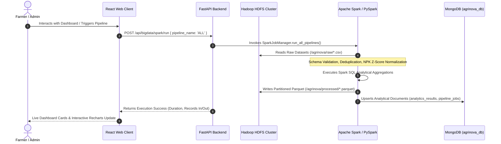
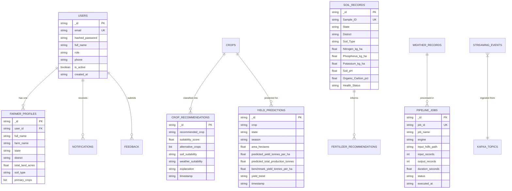

# AgriNova System Architecture & Data Engineering Specification
## High-Level Architecture, ETL Pipeline, and Database Schema

### 1. High-Level Distributed Architecture Diagram

```mermaid
flowchart TD
    subgraph Data Sources Layer
        S1["Automated Weather Stations (AWS)"]
        S2["IoT Field Probes (Soil Moisture & EC)"]
        S3["AGMARKNET Mandi Price Feeds"]
        S4["Historical ICAR & FAO Harvest Statistics"]
    end

    subgraph Real-Time Streaming Ingestion
        KP["AgriNova Kafka Event Producers"]
        KB["Apache Kafka Cluster\n(4 Topics: agrinova-weather, soil, market, irrigation)"]
        S1 --> KP
        S2 --> KP
        S3 --> KP
        KP --> KB
    end

    subgraph Distributed Big Data Storage (Hadoop HDFS)
        HDFS["Hadoop Distributed File System (HDFS 3.3.6)\nNameNode (Port 9870) + DataNodes\n/agrinova/raw/*\n/agrinova/processed/*\n/agrinova/analytics/*"]
        S4 --> HDFS
    end

    subgraph Distributed Processing Engine (Apache Spark & PySpark)
        SparkSS["Spark Structured Streaming\n(Tumbling Window Ingestion)"]
        SparkBatch["PySpark Distributed Batch ETL\n(Schema Validation, Deduplication, Feature Store)"]
        KB --> SparkSS
        HDFS <--> SparkBatch
        SparkBatch --> HDFS
    end

    subgraph Serving & Operational Layer
        MongoDB[("MongoDB 6.0 (agrinova_db)\n17 Collections: operational & aggregated analytics")]
        FastAPI["FastAPI High-Performance Async Backend\n(17 Routers, JWT Auth, Swagger UI)"]
        SparkSS --> MongoDB
        SparkBatch --> MongoDB
        FastAPI <--> MongoDB
        FastAPI <--> HDFS
    end

    subgraph Client Experience Layer
        Frontend["AgriNova Web Platform (React 18 + TS + Tailwind)\n22 Enterprise Pages & Live Visualizations"]
        FastAPI <--> Frontend
    end
```

---

### 2. PySpark Data Processing Flow (ETL Architecture)



---

### 3. MongoDB Document Database Design (`agrinova_db`)

The database architecture consists of 17 dedicated collections:


